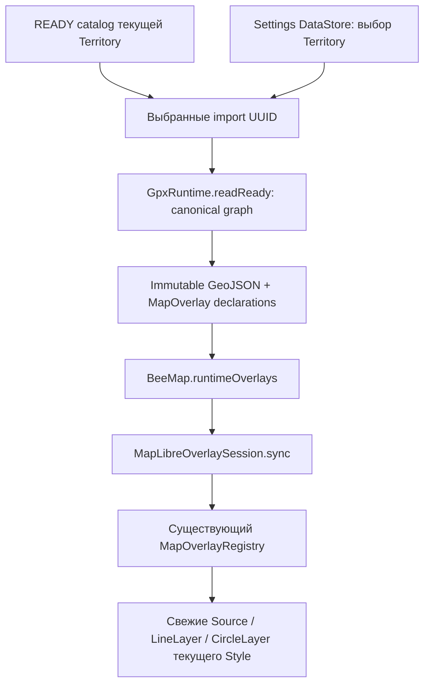

# Показать трек — макет v1

**Статус: APPROVED BY OWNER, 2026-10-19.**
Утверждён с обязательной коррекцией примера, выполненной в этой версии.
Повторное согласование не требуется. Реализация — отдельное задание.
Дата: 2026-10-19. Проверенная база: `fe1e700`, `task/d106-stage0-overlay-registry`.
Режим подготовки артефакта: DESIGN ONLY / TARGETED INTEGRATION CHECK.
Stage1/H05 остаются OPEN.

Реализация по этому утверждённому контракту выполнена отдельным заданием:
[отчёт и emulator screenshots](../../d106-gpx-display-implementation-report.md).
Разделы6–7 ниже фиксируют аудит/план на design-базе fe1e700, не текущий статус кода;
историческая граница design-задачи в конце не отменяет отдельное разрешение реализации.

Визуальный пакет:
- [gpx-display-v1.png](gpx-display-v1.png) — список и пустое состояние;
- [gpx-display-v1-font17.png](gpx-display-v1-font17.png) — отдельный полноразмерный
  Samsung-кадр с крупной типографикой, для физического просмотра статичного макета.
PNG задаёт композицию; этот MD — действия, данные, состояния и границы.
Статичный PNG не является работающей Compose-панелью и не проверяет runtime fontScale.
[Mockup-first](../Создание%20интерфейсов.md), [импорт v1](gpx-import-v1.md),
[решение OWNER](../../decisions.md#d106-user-data-navigation--owner-decision-2026-10-18),
[Stage1A](../../d106-stage1-gpx-spec.md#9-visible-overlay-contract--owner-amendment-b).

## 1. Вход и состав

`Карта → Визуализация → Данные на карте → Треки → Показать трек`.
Действие становится доступным только в будущем согласованном implementation slice;
текущий production `Показать трек / Скоро` этим макетом не активируется.

Тот же bottom sheet, ещё одна вложенная страница, без нового route/окна:
- стандартная стрелка `Назад` и заголовок `Показать трек`;
- вертикально прокручиваемый список READY импортов текущей Territory;
- одна строка = один импортированный GPX-файл (TrackImport), не одна линия;
- слева обычный switch, справа полное понятное имя; длинное имя переносится;
- без chevron у файлов, постоянных подсказок, счётчиков, UUID, SHA, координат,
  размеров, настроек, удаления/редактирования/экспорта и `Выбрать все`;
- нет `Применить`/`Сохранить`/`Готово`: сохранённый выбор действует сразу.

Названия примера иллюстративны. Основное имя — сохранённый displayName, не путь.
Если имя отсутствует/пустое, использовать `GPX от 19.10.2026, 07:40` из времени импорта
(это не время измерения). Только при совпадении имён добавить короткую дату/время
импорта; полное совпадение различить стабильным презентационным номером. Это не
новый persistent ID и не переименование источника. Упорядочить по importedAt
от новых к старым, stable UUID использовать только как невидимый tie-breaker.

## 2. Что включает один switch

**Утверждённая семантика:** один switch включает весь
поддерживаемый canonical graph выбранного TrackImport:
- все SourceTrack и их TrackSegment в исходном порядке;
- segment с >=2 samples — отдельная линия;
- segment с 1 sample — отдельная точка (Point/CircleLayer), чтобы singleton GPX
  был видимым;
- empty track/segment не создаёт пустую geometry;
- между tracks/segments нет соединительных линий, smoothing/snapping/decimation.

Условие «один файл = одна линия» запрещено. Файл может дать несколько независимых
линий и точек. Это не превращает samples в самостоятельные «Мои точки».
Профиль сейчас поддерживает `<trk>/<trkseg>/<trkpt>`; `<rte>/<wpt>` не canonicalized
и не начинают отображаться от этого UI. Исходный GPX сохраняется неизменным.
Геометрия строится из Room canonical graph, без повторного parsing оригинала.
Invalid coordinates отклоняются при импорте. Ordinal holes в stored graph —
integrity failure, не новый способ обозначить gap; gap уже задан границей сегмента.

Выбор нескольких строк показывает соответствующие импорты одновременно.
Выключение убирает только отображение этого импорта, не удаляя данные/оригинал.
Камера не перемещается автоматически при переключении: сохраняется текущий viewport.
Если геометрия вне окна, пользователь перемещает карту обычным способом; отдельные
zoom/fit controls в этот минимальный макет не входят.

## 3. Видимость и сохранение

- У каждого Territory свой device-local набор выбранных stable import UUID.
- Новый READY import без явного выбора остаётся **выключенным**.
- Завершение импорта не открывает список, не включает switch и не меняет камеру.
- Back/стрелка возвращают на страницу `Треки GPX`, сохраняя выбор.
- Повторное открытие и перезапуск приложения восстанавливают выбор этой Territory.
- Переход A→B→A не переносит выбор/запоздалую геометрию A в B.
- Сначала подтверждённое сохранение настройки, затем применение к presentation.
  Во время записи повторное действие строки блокируется; при ошибке записи вернуть
  предыдущее значение и показать короткое `Не удалось сохранить` / `Повторить`.

**Согласование Stage1A §10:** прежнее `default visible`/hidden IDs заменено
более поздним решением OWNER: новый импорт OFF, хранится явный выбранный набор
UUID. Импорт не добавляет ID в этот набор. Будущая restored-default policy и
Backup/Restore здесь не меняются и не реализуются.

## 4. Состояния

| Состояние | Вид / действие |
|---|---|
| Загрузка catalog/settings | Заголовок и progress; ещё не показывать ложный empty/OFF |
| Есть READY | Имя + switch; несколько ON допустимы; пример в левом кадре |
| Нет READY | `Нет сохранённых GPX`; стандартный Back; без пустых switches и нового import entry. Импорт остаётся на предыдущей странице |
| Все switches OFF | Обычный непустой список; не путать с отсутствием сохранённых GPX |
| Ошибка чтения списка | `Не удалось загрузить GPX`, `Повторить`; не выдавать за empty |
| Отрисовка выбранного файла готовится | Выбор сохранён, progress в его строке; не обещать готовый показ раньше attach |
| Renderer/ceiling failure | Сохранённый switch остаётся ON как выбор; явное `Не удалось показать` / `Повторить`, accessibility сообщает ошибку. Никакого молчаливого частичного пропуска canonical data |
| Предел presentation | Явное предложение отключить часть файлов и повторить; данные не удаляются, точные capacity limits не выдумываются |
| Оригинал отсутствует/повреждён/недоступен, canonical geometry исправна | Трек продолжает отображаться; обычные имя и switch без предупреждения об оригинале. Состояние оригинала может учитываться внутренней диагностикой |
| Есть unsupported content | При необходимости короткое `Не все данные GPX поддерживаются`; не подменять поддерживаемый canonical graph raw `<rte>/<wpt>`. Существующее предупреждение импорта не меняется |
| Canonical geometry повреждена/недоступна | Понятное сообщение `Не удалось показать трек` у конкретного файла. Не выдумывать geometry из оригинала и не смешивать эту ошибку с отсутствием оригинала при исправной canonical geometry |
| Смена Territory | Очистить transient content/progress, загрузить catalog/выбор новой Territory; старые результаты не публикуются |

Switch выражает **сохранённый выбор**, а не гарантию успешного native attach.
Loading/error явно различают эти состояния. Повторный показ не создаёт новый импорт.
Нет новых dialogs, редакторов, confirmation-on-hide или пустого экрана «Мои точки».

## 5. Samsung 1.7 / accessibility

Цель — Samsung SM-S938B,1080x2340, фактический system font_scale1.7,
density override480 (3px/dp), без изменения настройки телефона.
- >=48dp область switch/строки и Back; в reference switch rows56dp/168px.
- Вся строка может переключать значение; один accessibility switch node на импорт,
  имя файла + checked state, warning/error объявляются дополнительно.
- Длинные имена и статусы переносятся естественно, без ellipsis/вертикальных букв;
  switch не вытесняет/не перекрывает текст, шрифт не уменьшается ради размещения.
- Header/Back остаются доступны, список имеет один вертикальный scroll-контур.
- При большой высоте строк или длинном списке нижние файлы достигаются scroll.
  Screenshot статичного PNG не доказывает работоспособность scroll/semantics.
- Физический просмотр полного кадра фиксируется в evidence. Это design visual
  inspection: PNG не реагирует на системный fontScale и не заменяет проверку
  будущего Compose UI на Samsung после отдельного разрешённого deploy.

### Исторический просмотр черновика и проверка коррекции — 2026-10-19

Samsung RFCY90MBYVZ / SM-S938B: system font_scale1.7,1080x2340, density480.
Полноразмерный PNG открыт штатной Gallery, её элементы управления скрыты.
В просмотренном черновике длинное имя переносилось на две горизонтальные строки,
все три switches были видны; clipping/overlap не обнаружены. Этот screenshot
предшествует обязательной коррекции и не является изображением утверждённого PNG.
[Фактический screenshot просмотра](../../../build/evidence/d106-gpx-display-design-20261019/samsung-preview-clean.png).
Это просмотр изображения, не активная DEV-страница. PNG не реагирует на fontScale;
реальные sp/48dp, touch, scrolling и persistence ещё предстоит проверить на Compose
после реализации. DEV updateTime остался2026-10-19 07:47:23.
На телефоне был оставлен PNG черновика в Download для OWNER review; файлы приложения
не менялись. Никакой APK/production UI не устанавливался.

Коррекция OWNER: в обоих актуальных PNG третья строка — `Лесная дорога.gpx`,
switch ON, без предупреждения и значка. Проверены оба растровых файла, в том
числе полноразмерный Samsung companion: имя читается полностью. Пиксели вне
области текста третьей строки сохранены, включая переключатель, Back, остальные
строки и пустое состояние. Повторного физического просмотра исправленного PNG
в этой задаче не проводилось; runtime fontScale/touch/scroll этим не проверены.

## 6. Targeted integration check — OBSERVED

Проверено на fe1e700; production-код не изменялся.

| Уже есть | Источник |
|---|---|
| Generic MapOverlay: key/revision/factories/visible/order | [MapOverlayRegistry.kt](../../../app/src/main/java/org/beesearch/app/ui/map/MapOverlayRegistry.kt) |
| Register/update/unregister, scope/token/style correlation, safe cleanup | тот же Registry; [MapLibreOverlaySession.kt](../../../app/src/main/java/org/beesearch/app/ui/map/MapLibreOverlaySession.kt) |
| BeeMap runtimeOverlays + overlayScope, дефолт scope TerritoryUUID | [BeeMap.kt](../../../app/src/main/java/org/beesearch/app/ui/map/BeeMap.kt) |
| Production map сейчас не передаёт GPX declarations | [MainMapScreen.kt](../../../app/src/main/java/org/beesearch/app/ui/map/MainMapScreen.kt) |
| READY graph по importId после reconciliation и Territory check | [GpxRuntime.kt](../../../app/src/main/java/org/beesearch/app/data/gpx/GpxRuntime.kt), readReady(territoryId,importId) |
| Ordered canonical tracks/segments/samples и валидация | [GpxStoredGraph.kt](../../../app/src/main/java/org/beesearch/app/data/local/room/GpxStoredGraph.kt), [GpxCanonicalModel.kt](../../../app/src/main/java/org/beesearch/app/domain/gpx/GpxCanonicalModel.kt) |
| READY DAO только по ID, лёгкого списка территории нет | [GpxDao.kt](../../../app/src/main/java/org/beesearch/app/data/local/room/GpxDao.kt) |
| Per-Territory research visibility в общем Settings DataStore | [DataStoreMapDataDisplayStore.kt](../../../app/src/main/java/org/beesearch/app/data/local/settings/DataStoreMapDataDisplayStore.kt), [DataStoreSettingsRepository.kt](../../../app/src/main/java/org/beesearch/app/data/local/settings/DataStoreSettingsRepository.kt) |
| Original status enum/inspection, пока не экспонируется READY UI | [GpxOriginalStore.kt](../../../app/src/main/java/org/beesearch/app/data/gpx/GpxOriginalStore.kt) |

Registry существует и подходит; создавать второй Registry/renderer lifecycle не нужно.
Его visible — runtime RAM state, не persisted выбор между запусками. Research
MapDataType/фильтры не являются GPX настройками. Границы Source/Layer vs Compose:
[architecture §73.3](../../architecture.md#733-map-overlays-и-layers-принятое-разделение).

## 7. Минимальные будущие подключения — DERIVED / proposal, не реализация

1. Добавить лёгкое metadata чтение READY imports по territoryId в существующие
   DAO/persistence/runtime границы, без Room schema change и без geometry всех
   скрытых файлов. Catalog тоже проходит runtime reconciliation gate.
2. Сохранять выбранные import UUID отдельно от research visibility, в существующем
   Settings DataStore по тому же per-Territory pattern; новый файл данных/Room table
   не требуется. Persistence раньше успешного UI feedback. Registry не хранилище.
3. Для выбранных IDs использовать существующий readReady(T,I), а не повторно parser
   или original GPX URI. Отсутствие/corruption оригинала никогда не блокирует
   canonical rendering и не требует предупреждения в списке. Состояние оригинала
   допустимо учитывать во внутренней диагностике существующего OriginalStore;
   добавлять его в пользовательскую строку для показа трека не требуется.
4. Подготовить immutable visible-set GeoJSON/declarations: proposed overlay/import
   `gpx-<importUUID>`, local source `geometry`, layer `lines` и для singleton
   segments слой `singletons`. Это уже предусмотрено Stage1A §9; никаких SDK ID из имён.
   На factories подавать подготовленные snapshots, создавать свежие стандартные
   SDK Source/Layer. Scope/revision/token отвергают позднюю работу старой Territory.
5. Передать GPX declarations в существующий BeeMap.runtimeOverlays, сохранив другие
   overlays. Hidden imports не удерживают полный GeoJSON/native Source/Layer:
   убрать только их declarations через unregister существующего Registry. Повторный
   show строит fresh objects; смена basemap использует уже существующее восстановление.
6. presentation ceilings отдельно от import/storage capacity: чисел здесь нет,
   нужен bounded producer и целевые native/device измерения в implementation slice.
   Не молча обрезать файлы и не «исправлять» canonical data для рендера.

Минимальные механизмы MapLibre уже есть: GeoJsonSource с FeatureCollection,
LineLayer и CircleLayer; новая библиотека/adapter framework не требуются.
Проверены первичные исходники именно установленной Android13.5.1:
[GeoJsonSource](https://github.com/maplibre/maplibre-native/blob/android-v13.5.1/platform/android/MapLibreAndroid/src/main/java/org/maplibre/android/style/sources/GeoJsonSource.kt),
[LineLayer](https://github.com/maplibre/maplibre-native/blob/android-v13.5.1/platform/android/MapLibreAndroid/src/main/java/org/maplibre/android/style/layers/LineLayer.java).
Последняя API-страница сайта сейчас13.6.1, не принималась за доказательство13.5.1.

## 8. Утверждение OWNER — 2026-10-19

PNG+MD утверждены OWNER с единственной обязательной коррекцией примера:
`Лесная дорога.gpx`, switch ON, без предупреждения об оригинале. Коррекция
выполнена в обоих PNG; повторное согласование не требуется.

Утверждены один switch на импорт, несколько одновременно видимых файлов,
новый импорт OFF, persistent visibility per Territory, независимость импорта
и показа, singleton segments отдельными точками и существующий Registry.
Дополнительных решений OWNER по этому макету не осталось. Реализация списка
и отображения начинается только как следующее отдельное задание.

## 9. Будущая приёмка после разрешения implementation

- READY list/current Territory, empty/error/all-OFF различимы;
- multi-file ON/OFF и сохранение/restart без нового импорта;
- импорт не добавляет новый ID в visible set;
- multiple tracks/segments, empty/singleton, реальные gaps без bridge;
- missing/corrupt original + валидная canonical geometry: показ продолжается
  без предупреждения об оригинале в списке; canonical failure даёт ошибку файла;
- original и canonical integrity failure не смешиваются;
- style reload/fresh SDK objects, hide/unregister/show, A→B→A stale rejection;
- persistence/renderer errors не дают ложного success или silent omission;
- реальный Samsung1.7: long/duplicate/missing filenames,48dp, scroll, Back,
  контраст и сравнение с утверждённым PNG. Значения capacity мерить, не угадывать.

В текущей задаче не было production UI/rendering, Room migration, удаления,
редактирования, экспорта, «Мои точки», Backup/Restore или Android Auto Backup.
Импорт v1 и его утверждённые артефакты не менялись. Разрешён один локальный
commit утверждённых артефактов и документации; push запрещён.
Следующее отдельное задание — реализация согласованного списка/показа;
автоматически он не начинается. Stage1/H05 OPEN.
